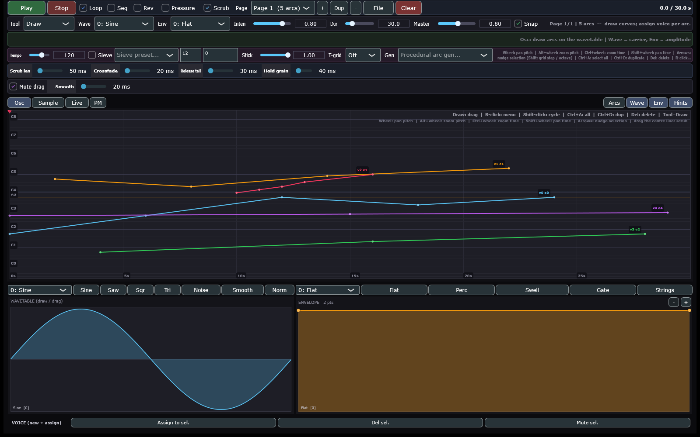
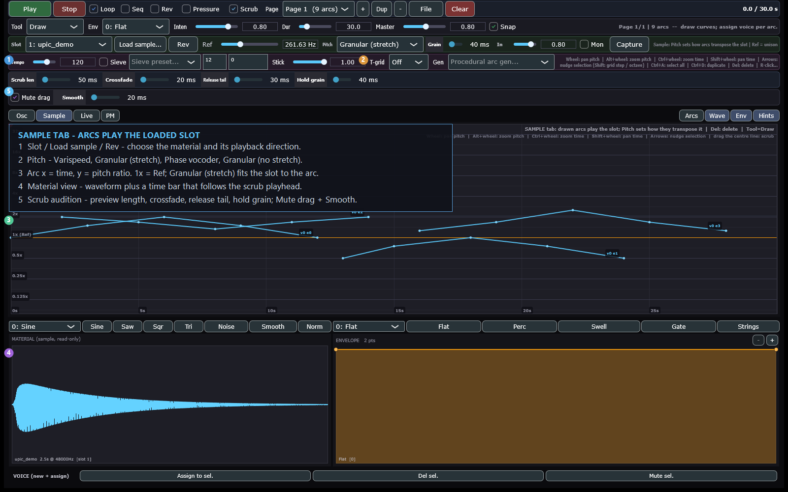
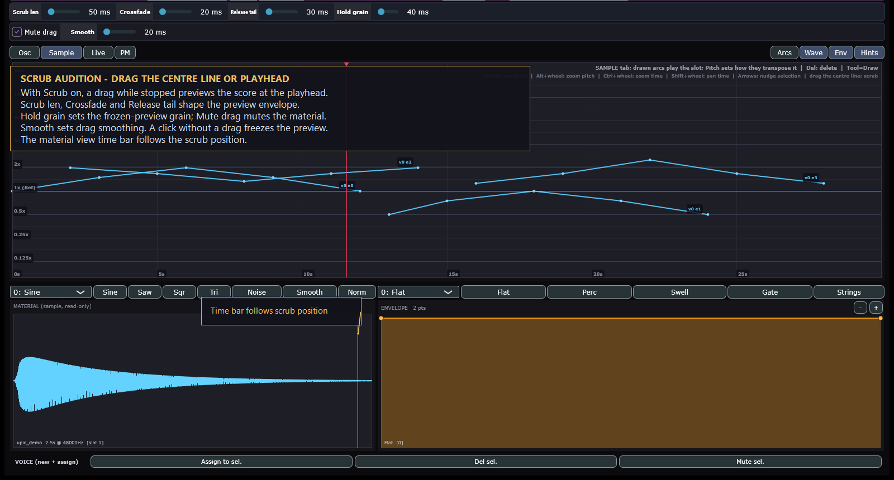

# UPICuitous - A JUCE-based UPIC clone: the classic oscillator graph becomes sound, and the same score can drive sample and live audio graphs with pitch change. Supports Windows standalone, VST3 plugin, and Android app.

A homage to Iannis Xenakis' UPIC (1977): draw pitch curves on a
time-vs-pitch page, give each arc a single-cycle wavetable and an
amplitude envelope, and hear it. The same score can drive three
materials: oscillators, loaded samples (pitch-shifted) and the live
microphone input (pitch-shifted in realtime).

Ships as a **desktop app**, an **Android tablet app**, and a **VST3
plugin** with the same UI and engine.

## Screenshots



*Overview: the score page with the Osc material layer selected. Draw
pitch arcs over time; each tab is a separate material on the same page.*



*Focused: the Sample tab. Load a slot, draw arcs on the ratio grid, and
choose the pitch mode. Arc x is time; arc y is the playback ratio
(1x = Ref). Granular (stretch) fits the slot to the arc length;
Varispeed changes the slot's playback length with pitch; Granular
(no stretch) and Phase vocoder keep the slot's length and shift pitch
only. The material view shows the waveform and a time bar; drag the
centre line to scrub.*

## Builds in this repo

| Build | Where | State |
|---|---|---|
| JUCE C++ (desktop + Android + VST3) | `Source/`, `Plugin/`, `Builds/Android/` | The main build. v0.28.0 |
| Python + tkinter + numpy | `python-upic/` | Prototype, shares `.upic.json`. `python python-upic/upicuitous.py` |
| Single-page WebAudio | `web-upic/` | Prototype, shares `.upic.json`. Open `web-upic/index.html` |

## Quick start

```powershell
# Everything: app (Debug) + selftest + VST3 (Release) + smoke test + pluginval
.\scripts\build.ps1

# Standalone
.\Builds\VisualStudio2026\x64\Debug\App\UPICuitous.exe

# VST3 (built by the script; the install asks for admin rights)
.\scripts\install_plugin.ps1 -Version 0.28.0
```

`scripts/build.ps1 -Version 0.28.0` bumps the app and plugin version
together. `-SkipApp` or `-SkipPlugin` narrows the run.

First run of the standalone: press **Audio** and pick the output device.
The microphone is opened on demand (Sample tab -> **Mon** / **Capture**, or
**Play** with live arcs on the page).

## What it does

**One tab strip - Osc | Sample | Live | PM.** Each tab is a material and its
own canvas layer, on the same page and timeline. Switching tabs is
instant and never touches the audio device.

**Score page**

- X = time (5-120 s per page), Y = log pitch 20 Hz - 12 kHz.
- Tools: Draw (snap), Line, Sine, Erase, Select/Move, Zone.
- Magnetic sieve zones with their own sieve + time grid; global sieve
  (Xenakis `n mod m` remainders), stickiness, time grid, presets.
- Procedural generators: stochastic / convergent arborescence, echelon,
  ordinal spine.
- Multi-select: Ctrl+A, Ctrl+C (count), Ctrl+D, Del, arrow nudge,
  Shift-click cycling, right-click menu.
- Wheel: pan pitch, Alt+wheel zoom pitch, Ctrl+wheel zoom time,
  Shift+wheel pan time; drag the centre line or the playhead triangle to scrub.
- Touch: 1 finger draws/selects/scrubs, pinch zooms, two-finger drag
  pans, long-press opens the context menu.

**Osc tab** - arcs play drawable 1024-sample wavetables (Sine/Saw/
Square/Triangle/Noise/Reed + Smooth/Normalize) through drawable
envelopes (Flat/Percussive/Swell/Gate/Strings). With an arc selected, a
shape edit forks a private copy when an unselected arc shares the wave,
so it only changes the selection. The envelope is a point
curve: **+** adds a point (tap the curve first to place it, otherwise it
splits the widest gap or the segment after the selected point), **-**
removes the selected point(s), dragging moves it. Ctrl/Cmd/Shift-click
adds points to a group and dragging one moves the whole group.
Double-click adds and right-click deletes as before.

**Sample tab** - four slots: load wav/flac/ogg/aiff, record from the mic,
In/Mon/Capture, input gain. `Ref` is the material's base pitch; arc pitch
sets the playback ratio. Pitch modes: **Varispeed** (default),
**Granular (stretch)**, **Phase vocoder**, **Granular (no stretch)**. At 1x
(the arc sits on Ref) the pitch is unchanged; draw above or below Ref to
transpose. Varispeed changes the slot's playback length with pitch;
Granular (no stretch) and Phase vocoder keep the slot's length and shift
pitch only; Granular (stretch) time-stretches the slot to the arc length.
Sample-speed grid labels Ref x 2^k.
The **Rev** button plays the selected slot backwards - the material is
mirrored, the pitch stays the same.

**PM tab** - phase-modulation arcs: Ratio, Index, index envelope,
Feedback and 2/4 operators, with bell / brass / pluck presets. The PM
toolbar values are also the values of the next PM arc drawn, and editing
them with a selection updates the selected PM arcs.

**Live tab** - drawn arcs multiply the microphone pitch in realtime.
Pitch modes: **Granular** (default), **Tape**, **Phase vocoder**, with a
range of 1/16x - 16x (four octaves each way). The grid is the multiply
ratio grid: **1x** is the input as-is, **2x** an octave up. `Ref` is the
1x input pitch and retunes the selected live arcs. The **Rev**
button in the material row plays the microphone's last 0.5 / 1 / 2 seconds
**backwards** (the buffer duration is yours to pick).

**Arcs panel** - the **Arcs** toggle (with the Wave / Env / Hints
toggles) opens a list of the arcs on the right: grouped OSC / SAMPLE /
LIVE / PM, each row with the arc's pitch range, its time span and its
page. Clicking a row selects the arc on the canvas and switches to its
tab; Ctrl/Cmd/Shift-click adds it to a multi-selection. The sample and the
live rows carry a **Rev** box (that arc's material backwards) and a
**mode** dropdown (that arc's pitch-shift algorithm).

**MIDI in** - the Audio Settings overlay lists the MIDI inputs (`None`
when there is none), shows the last message (CC or note, value, channel,
device) and has a **Learn** row for the master gain and the draw
intensity: press Learn, move a control, and the parameter follows it.
The bindings are a controller map - session state, not part of the piece.

**Transport and IO** - Play/Stop with click-free fades, Loop, page
sequencer (SEQ), WAV render, per-voice stems, `.upic.json` save/load
(shared with the Python and web builds). Double-click Stop rewinds to the
start. Clear asks first in an in-app warning and uses a red confirm
button. Dragging the playhead while stopped now plays a short scrub
preview. A Rev toggle runs the score backwards (a mirrored stroke sounds mirrored); a learned MIDI jog CC drives a signed, smoothed playhead (up to +/- 4x) in the app and the plugin.

**Scrub audition** - with Scrub on, dragging the centre line or the
playhead triangle plays a short preview while the transport is stopped.
The toolbar sets **Scrub len**, **Crossfade**, **Release tail** and
**Hold grain**; **Mute drag** mutes the material while editing, and
**Smooth** sets the drag smoothing. A click without a drag holds the
preview; releasing after a drag does not start playback.



*Focused: scrub audition. The scrub row shapes the preview; the material
view time bar follows the playhead during playback and while dragging.*

## VST3 plugin

`Plugin/` builds the same `MainComponent` as a VST3: host audio in/out,
host state save/load, host latency reporting. The Live tab reads the
plugin's input bus (put it on an audio track and the live arcs process
that audio).

The live shifters have an inherent delay - granular 220 ms, tape
40-200 ms, phase vocoder about 21 ms. The host is told the delay only
when every audible arc on the page is delayed (a live-only page); a page
that mixes generator arcs with live arcs reports 0, because the score
must stay sample-accurate. The status line shows the current value
(`LAT 220ms`).

## Layout

```
Source/              JUCE app + shared engine/UI
  UpicModel.h        Waveform / Envelope / Arc / Page / zones + JSON
  UpicEngine.h       realtime + offline renderer, sample voices
  LivePitch.h        granular / tape / phase-vocoder shifters
  ScoreEditor.h      score canvas, tools, touch, grids
  WaveformEditor.h   wavetable drawing
  EnvelopeEditor.h   envelope drawing
  MainComponent.*    tabs, transport, pages, file IO, audio, status
  AndroidBars.h      Android status/nav bar helpers
  Main.cpp           entry, --selftest
Plugin/              VST3 wrapper (CMake): processor, editor, smoke test
scripts/             build.ps1, install_plugin.ps1, fix_android.ps1,
                     check_juce.ps1, fetch_pluginval.ps1
Builds/Android/      Android Studio project (Gradle + CMake)
Builds/VisualStudio2026/  generated Projucer solution (not committed)
python-upic/         tkinter + numpy prototype
web-upic/            single-file browser sketch
```

## Requirements

- Windows with **Visual Studio 2026** (Desktop development with C++),
  MSBuild and CMake 3.22+.
- **JUCE 8.0.6** in `JUCE/` (the app CMakeLists also fetches it if
  missing; `python Tools/fetch_juce.py` downloads it without git).
- MinGW is not supported by JUCE 8 - use MSVC.
- Android: JDK 17, SDK 35, NDK 28.1.13356709, CMake 3.22.1.

## Tests

`UPICuitous.exe --selftest` runs 335 headless checks (DSP, pitch math,
all seven pitch modes, click guard, JSON round-trip, UI layout sweep,
tab wiring, latency rules, the lock-free model snapshot, the sample
reverse read, the live reverse, the arc list, the MIDI input, the
envelope points, the multi-selection / toolbar edits, the
wavetable fork / Stop rewind / Clear warning checks and the
granular-vs-varispeed regression) and writes the log to
`%TEMP%\upic_selftest.txt`. The build script also runs the 15-check
plugin smoke test and pluginval at strictness 5.

## Xenakis notes

Original UPIC: electromagnetic pen + tablet -> VAX -> DAC. Vertical =
log pitch, horizontal = time; waveform and envelope drawn separately and
assigned to arcs. This clone keeps that triptych: **Page / Wavetable /
Envelope**, and adds samples and live input as further materials.


