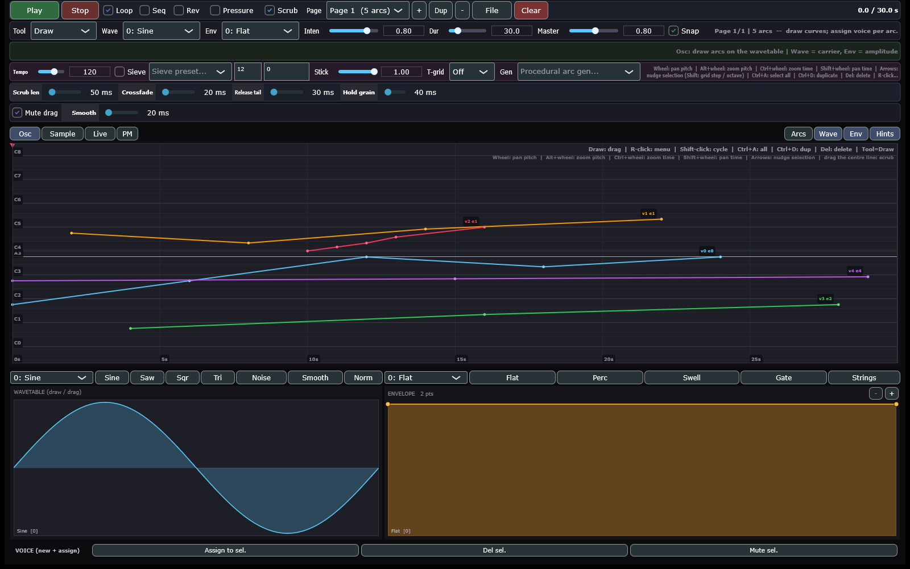
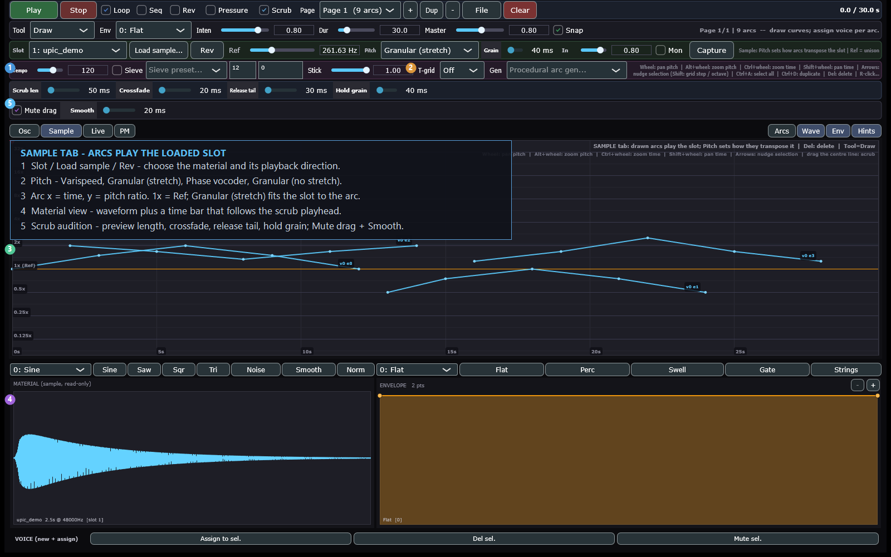
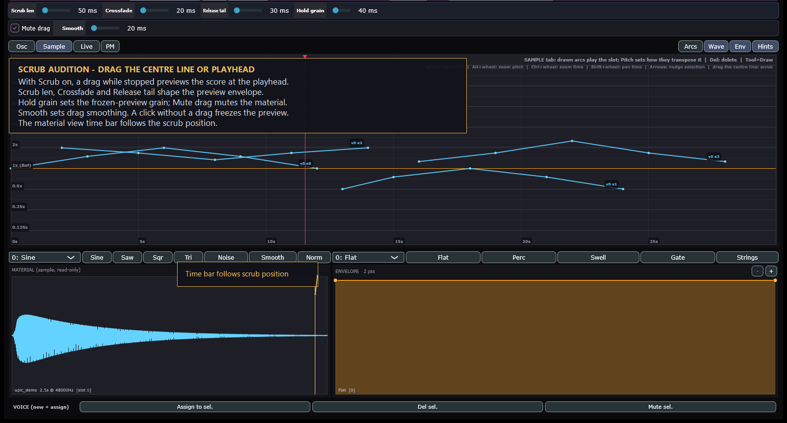

# UPICuitous - A JUCE-based UPIC clone: the classic oscillator graph becomes sound, and the same score can drive sample and live audio graphs with pitch change. Supports Windows standalone, VST3 plugin, and Android app.

A homage to Iannis Xenakis' UPIC (1977): draw pitch curves on a
time-vs-pitch page, give each arc a single-cycle wavetable and an
amplitude envelope, and hear it. The same score can drive three
materials: oscillators, loaded samples (pitch-shifted) and the live
microphone input (pitch-shifted in realtime).

Ships as a **desktop app**, an **Android tablet app**, and a **VST3
plugin** with the same UI and engine.

## Screenshots



*Overview: the score page with the Osc material layer selected. Draw
pitch arcs over time; each tab is a separate material on the same page.*



*Focused: the Sample tab. Load a slot, draw arcs on the ratio grid, and
choose the pitch mode. Arc x is time; arc y is the playback ratio
(1x = Ref). Granular (stretch) fits the slot to the arc length;
Varispeed and Granular (no stretch) change the slot's playback length
with pitch; Phase vocoder shifts pitch only. The material view shows the
waveform and a time bar; drag the centre line to scrub.*

## Builds in this repo

| Build | Where | State |
|---|---|---|
| JUCE C++ (desktop + Android + VST3) | `Source/`, `Plugin/`, `Builds/Android/` | The main build. v0.28.0 |
| Python + tkinter + numpy | `python-upic/` | Prototype, shares `.upic.json`. `python python-upic/upicuitous.py` |
| Single-page WebAudio | `web-upic/` | Prototype, shares `.upic.json`. Open `web-upic/index.html` |

## Quick start

```powershell
# Everything: app (Debug) + selftest + VST3 (Release) + smoke test + pluginval
.\scripts\build.ps1

# Standalone
.\Builds\VisualStudio2026\x64\Debug\App\UPICuitous.exe

# VST3 (built by the script; the install asks for admin rights)
.\scripts\install_plugin.ps1 -Version 0.28.0
```

`scripts/build.ps1 -Version 0.28.0` bumps the app and plugin version
together. `-SkipApp` or `-SkipPlugin` narrows the run. See `BUILDING.md`
for the manual CMake commands, the Android project and troubleshooting.

First run of the standalone: press **Audio** and pick the output device.
The microphone is opened on demand (Sample tab -> **Mon** / **Capture**, or
**Play** with live arcs on the page).

## What it does

**One tab strip - Osc | Sample | Live | PM.** Each tab is a material and its
own canvas layer, on the same page and timeline. Switching tabs is
instant and never touches the audio device (v1.17).

**Score page**

- X = time (5-120 s per page), Y = log pitch 20 Hz - 12 kHz.
- Tools: Draw (snap), Line, Sine, Erase, Select/Move, Zone.
- Magnetic sieve zones with their own sieve + time grid; global sieve
  (Xenakis `n mod m` remainders), stickiness, time grid, presets.
- **The sieve row** - the quantisers, and what each one does:
  - **Sieve** + **m** + **R** quantise the drawing's **pitches**: only the
    pitches whose MIDI number is `n mod m` in the remainder list are
    allowed, so the curve becomes a staircase of steps.
  - **Stick** is the one global knob: how strongly the drawing is pulled
    toward whatever magnet is active - the sieve (the pitches), a zone's
    own sieve, and the time grid (the times). 1 is a hard snap, 0 leaves
    the drawing free. **The sieve zones follow it too**: a zone has its
    own `m`/`R` and its own time grid, but there is one stickiness.
  - **T-grid** quantises the drawing's **times**. The points are pulled
    toward the grid by the stickiness, so the curve takes the grid's
    shape; Off leaves the times free.
  - **Ambitus**, **Accel** and **S1-S4** are the page's own settings (see
    below); the S labels show how many arcs are in each space.
- **Sieve zones** - the Zone tool draws a magnetic region: inside it the
  points snap to *that zone's* sieve and time grid. A zone can be
  **dragged to a new place** (inside it) or **resized by an edge or a
  corner**; right-click a zone to delete it or to give it the sieve or the
  time grid the toolbar is showing now.
- Procedural generators: stochastic / convergent arborescence, echelon,
  ordinal spine.
- Multi-select: Ctrl+A, Ctrl+C (count), Ctrl+D, Del, arrow nudge,
  Shift-click cycling, right-click menu.
- Wheel: pan pitch, Alt+wheel zoom pitch, Ctrl+wheel zoom time,
  Shift+wheel pan time; drag the centre line or the playhead triangle to scrub.
- Touch: 1 finger draws/selects/scrubs, pinch zooms, two-finger drag
  pans, long-press opens the context menu.

**Osc tab** - arcs play drawable 1024-sample wavetables (Sine/Saw/
Square/Triangle/Noise/Reed + Smooth/Normalize) through drawable
envelopes (Flat/Percussive/Swell/Gate/Strings). With an arc selected, a
shape edit forks a private copy when an unselected arc shares the wave,
so it only changes the selection. The envelope is a point
curve: **+** adds a point (tap the curve first to place it, otherwise it
splits the widest gap or the segment after the selected point), **-**
removes the selected point(s), dragging moves it. Ctrl/Cmd/Shift-click
adds points to a group and dragging one moves the whole group.
Double-click adds and right-click deletes as before.

**The wave can be more than a timbre** - the UPIC's central idea: *once
a line or curve has been drawn, nothing is really decided about its
interpretation as a signal*. The Osc tab's material row says **Wave as**:
*Oscillator* (the classic case), *+ Amplitude LFO* (the curve also
shapes the loudness) or *+ Frequency LFO* (the curve also moves the
pitch - a fixed pitch or a glissando). **Rate** is the LFO's speed
(0.05-20 Hz) and **Depth** how deep it goes (1 is an octave of pitch, or
a full swing of the amplitude). They edit the selected arcs, and the
settings travel with the piece.

**Sample tab** - four slots: load wav/flac/ogg/aiff, record from the mic,
In/Mon/Capture, input gain. `Ref` is the material's base pitch; arc pitch
sets the playback ratio. Pitch modes: **Varispeed** (default),
**Granular (stretch)**, **Phase vocoder**, **Granular (no stretch)**. At 1x
(the arc sits on Ref) the pitch is unchanged; draw above or below Ref to
transpose. Varispeed and Granular (no stretch) change the slot's playback
length with pitch; Granular (stretch) time-stretches the slot to the arc
length; Phase vocoder keeps the slot's length and shifts pitch only.
Sample-speed grid labels Ref x 2^k.
The **Rev** button plays the selected slot backwards - the material is
mirrored, the pitch stays the same. **Slot -> Wave** turns the selected
slot into a wavetable - the UPIC's digitised wave page, where the take
becomes one loop of the oscillator (the pitch then follows the arc).

**PM tab** - phase-modulation arcs: Ratio, Index, index envelope,
Feedback and 2/4 operators, with bell / brass / pluck presets. The PM
toolbar values are also the values of the next PM arc drawn, and editing
them with a selection updates the selected PM arcs.

**Live tab** - drawn arcs multiply the microphone pitch in realtime.
Pitch modes: **Granular** (default), **Tape**, **Phase vocoder**, with a
range of 1/16x - 16x (four octaves each way). The grid is the multiply
ratio grid: **1x** is the input as-is, **2x** an octave up. `Ref` is the
1x input pitch and retunes the selected live arcs. **Grain** sets the
granular grain size from 5 to 500 ms (default 40 ms). The **Rev**
button in the material row plays the microphone's last 0.5 / 1 / 2 seconds
**backwards** (the buffer duration is yours to pick). When the global
**Rev** toggle is on, every live arc reads the mirrored input ring
regardless of that arc's Rev box.

**Arcs panel** - the **Arcs** toggle (with the Wave / Env / Hints
toggles) opens a list of the arcs on the right: grouped OSC / SAMPLE /
LIVE / PM, each row with the arc's pitch range, its time span and its
page. Clicking a row selects the arc on the canvas and switches to its
tab; Ctrl/Cmd/Shift-click adds it to a multi-selection. The sample and the
live rows carry a **Rev** box (that arc's material backwards) and a
**mode** dropdown (that arc's pitch-shift algorithm).

**MIDI in** - the **MIDI + OSC settings** overlay (the toolbar Settings
button or the menu) lists the MIDI inputs (`None` when there is none),
shows the last message (CC or note, value, channel, device) and has a
**Learn** row for the master gain and the draw intensity: press Learn,
move a control, and the parameter follows it. The bindings are a
controller map - session state, not part of the piece.

**Transport and IO** - Play/Stop with click-free fades, Loop, page
sequencer (SEQ), WAV render, per-voice stems, `.upic.json` save/load
(shared with the Python and web builds). Double-click Stop rewinds to the
start. Clear asks first in an in-app warning and uses a red confirm
button. Dragging the playhead while stopped now plays a short scrub
preview. A Rev toggle runs the score backwards (a mirrored stroke sounds mirrored); a learned MIDI jog CC drives a signed, smoothed playhead (up to +/- 4x) in the app and the plugin.

**Transforming the page** - the UPIC could transpose, reverse and invert a
composition. The File menu's **Transform the page...** submenu carries the
classical transformation family, applied to the selected arcs if there is
a selection and to every arc of the page otherwise:

- **Transpose** up or down an octave or a semitone.
- **Invert the pitch** - mirrors the drawn contour (a rising line becomes
  a falling one of the same size; the canvas is log-pitch, so this is
  what flipping the drawing upside down does, and inverting twice gives
  the page back).
- **Retrograde** - mirrors it in time, so the contour reads backwards
  inside its own span.
- **Augment / diminish** - stretches or compresses it in time (x2, x0.5):
  the same shape, played slower or faster.

**Page duration** - the page's clock, from **5 ms** to **12 minutes**
(the UPIC's own range: a drawing could sit in micro-time as well as in
macro-time). The Dur slider's travel is skewed so 30 s sits in the
middle, and the value box takes an exact number.

**The discrete frequency space** - the UPIC's frequency space could be the
continuum, where a diagonal line is a glissando, or *discrete*, with equal
temperaments of 1 to 99 divisions per octave: *"the same diagonal arc
would then sound like discrete steps in a defined temperament"*. The
voice row's **Stepped** box and its **Div/oct** slider do this: the arc's
sounding pitch is moved through the temperament, so a glissando is heard
as a staircase of discrete steps while the line on the canvas stays a
smooth curve. It is not the sieve - the sieve snaps the *drawn points*,
this snaps the *pitch that plays*. 12 divisions is the chromatic scale,
19 and 31 the tempered ones, 7 the diatonic one; the scale is anchored
at middle C. The setting belongs to the selected arc (and to the next
one drawn) and travels with the piece.

**The four frequency spaces** - the UPIC's real-time versions had a
*Frequency Table*: *"a composer could choose to operate within up to four
different simultaneous tables or grids that could be superimposed on each
page. These grids were invisible to the eye, however, and accessed by
assigning one of four tables to whatever arc was being drawn, the same
way as one would assign the waveform or envelope to it."*

So a page carries **four frequency spaces** (the sieve row's **S1-S4**)
and an arc names the one it is played in (the voice row's **Space**), the
way it names its wave or its envelope. A space is a range of the
frequency axis: the position of the drawing on the page's vertical axis
is mapped into it, so the same curve can be heard in another register
(**An octave up**, **An octave down**) or with its intervals scaled
(**Half the range**, **Double the range**). Two arcs can sit in two
spaces at once, and the drawing itself never moves. The S labels show
how many arcs are in each space - changing a space that holds no arc
changes nothing you can hear until you put one there.

**The page's interval and its acceleration** - *"the scale of the
millimetric surface could be selected, so that the vertical axis could
correspond to any interval"* - the **Ambitus** picks the interval the
page's vertical axis covers: the whole range, the 1990s UPIC's
0.01 Hz - 22 kHz, six octaves, three, one, or a single semitone. The
page is a page for that interval: the drawing lives inside it, and the
stepping, the nudge and the spaces all follow it.

**Accel** is the page's acceleration: *"the expansion and contraction of a
page (with the additional option of acceleration and deceleration)"* -
the page's own time runs at a varying rate. Positive starts slow and
speeds up, negative starts fast and slows down; the page still lasts as
long, the time is redistributed inside it. The WAV render follows the
same sweep, so an export sounds like the session.

**Scrub audition** - with Scrub on, dragging the centre line or the
playhead triangle plays a short preview while the transport is stopped.
The toolbar sets **Scrub len**, **Crossfade**, **Release tail** and
**Hold grain**; **Mute drag** mutes the material while editing, and
**Smooth** sets the drag smoothing. A click without a drag holds the
preview; releasing after a drag does not start playback.



*Focused: scrub audition. The scrub row shapes the preview; the material
view time bar follows the playhead while dragging.*

**Phone / MobMuPlat scrub (OSC)** - UPICuitous listens on UDP port 9000 and
also joins MobMuPlat's default multicast output `224.0.0.1:54321`, so the
controller works even when the phone cannot save a custom output IP.
Send a float `/upic/scrub <0..1>` (alias `/upic/scrub/pos`) to move the
playhead: 0 is the page start and 1 is the page end. The value feeds the
same seek and scrub-preview path as a canvas drag. Values keep the
preview alive; 2000 ms after the last message the gesture ends (holding
freezes the preview), and releasing never starts playback. The status line shows `OSC 9000` (plus
`MCAST` when the multicast listener is active). A ready-made MobMuPlat
patch lives in `docs/mobmuplat/`: load `UPICuitous-Scrub.mmp`, then set
MobMuPlat's Network output address to the computer's LAN IP and the output
port to 9000 (or leave the defaults). The slider sends values while it is
dragged. The **MIDI + OSC settings** overlay can change the UDP port,
turn multicast on or off, and change the multicast group and port; press
**Apply** to rebind the receivers. These endpoint changes are session-only.

## VST3 plugin

`Plugin/` builds the same `MainComponent` as a VST3: host audio in/out,
host state save/load, host latency reporting. The Live tab reads the
plugin's input bus (put it on an audio track and the live arcs process
that audio).

The live shifters have an inherent delay - granular 220 ms, tape
40-200 ms, phase vocoder about 21 ms. The host is told the delay only
when every audible arc on the page is delayed (a live-only page); a page
that mixes generator arcs with live arcs reports 0, because the score
must stay sample-accurate. The status line shows the current value
(`LAT 220ms`).

## Layout

```
Source/              JUCE app + shared engine/UI
  UpicModel.h        Waveform / Envelope / Arc / Page / zones + JSON
  UpicEngine.h       realtime + offline renderer, sample voices
  LivePitch.h        granular / tape / phase-vocoder shifters
  ScoreEditor.h      score canvas, tools, touch, grids
  WaveformEditor.h   wavetable drawing
  EnvelopeEditor.h   envelope drawing
  MainComponent.*    tabs, transport, pages, file IO, audio, status
  AndroidBars.h      Android status/nav bar helpers
  Main.cpp           entry, --selftest
Plugin/              VST3 wrapper (CMake): processor, editor, smoke test
scripts/             build.ps1, install_plugin.ps1, fix_android.ps1,
                     check_juce.ps1, fetch_pluginval.ps1
Builds/Android/      Android Studio project (Gradle + CMake)
Builds/VisualStudio2026/  generated Projucer solution (not committed)
docs/waves/          design notes per wave (index: docs/waves/README.md)
docs/android-build.md  what the .jucer owns and what the script owns
python-upic/         tkinter + numpy prototype
web-upic/            single-file browser sketch
FUTURE_IDEAS.md      roadmap: MIDI scrub/reverse, FM/PM, FM8 bridge, DAW sync
TOOLKITS.md          agent toolkits: what is used and why
known-issues.yaml    the recurring failures: symptom, cause, fix, prevention
PROGRESS.md          wave log, features, decisions, test inventory
```

## Requirements

- Windows with **Visual Studio 2026** (Desktop development with C++),
  MSBuild and CMake 3.22+.
- **JUCE 8.0.6** in `JUCE/` (the app CMakeLists also fetches it if
  missing; `python Tools/fetch_juce.py` downloads it without git).
- MinGW is not supported by JUCE 8 - use MSVC.
- Android: JDK 17, SDK 35, NDK 28.1.13356709, CMake 3.22.1 (see
  `BUILDING.md`).

## Tests

`UPICuitous.exe --selftest` runs 444 headless checks (DSP, pitch math,
all seven pitch modes, click guard, JSON round-trip, UI layout sweep,
tab wiring, latency rules, the lock-free model snapshot, the sample
reverse read, the live reverse, the live grain size, the forced live
reverse under the global Rev toggle, the MIDI + OSC settings overlay,
the arc list, the MIDI input, the envelope points, the v1.26
multi-selection / toolbar edits, the v1.27
wavetable fork / Stop rewind / Clear warning checks, the granular-vs-varispeed
regression and the UPIC's transformations (transpose, invert, retrograde,
augment), the discrete frequency space, the four frequency spaces, the
ambitus, the infrasonic-to-ultrasound range, the page's acceleration, the
movable sieve zones, the quantised line, the digitised wave page and the
micro-time page) and writes the log to
`%TEMP%\upic_selftest.txt`. The build script also runs the 15-check
plugin smoke test and pluginval at strictness 5.

## Xenakis notes

Original UPIC: electromagnetic pen + tablet -> VAX -> DAC. Vertical =
log pitch, horizontal = time; waveform and envelope drawn separately and
assigned to arcs. This clone keeps that triptych: **Page / Wavetable /
Envelope**, and adds samples and live input as further materials.

The UPIC's details here are checked against **"From Xenakis's UPIC to
Graphic Notation Today"** (Hatje Cantz / ZKM, 2024, open access) -
François-Bernard Mâche's "The UPIC Upside Down" and Brigitte Robindoré's
"Beyond the Continuum" - and against the official Xenakis dictionary
entry (Di Scipio, 2023).

Next: see `FUTURE_IDEAS.md` and the Kanso board. The signed playhead,
MIDI scrub, live reverse and PM voice shipped in v1.25; the FM8 bridge,
the full FM engine and DAW sync are still flagged as future ideas.
